# Base de datos — Gramalote Interactivo

**Motor elegido:** MySQL 8.0+ (InnoDB, `utf8mb4`).
**Estado:** esquema propuesto y validado en MySQL 8.4.11.
**Archivos:**

- `schema.sql` — 33 tablas + 3 vistas. Crea desde cero y **elimina** las tablas
  existentes del esquema `gramalote`.
- `seed.sql` — catálogos, navegación, configuración y las 4 secciones de
  Curiosidades. No incluye todavía el inventario completo.
- `../docker-compose.yml` — MySQL local en el puerto `3307`.
- `../.env.example` — variables de conexión de ejemplo.

> Antes de este cambio no existía ningún esquema: `backend/` solo tenía un
> README y el frontend trabajaba con datos locales en `src/data/`. Este es el
> punto de partida para la API.

## 1. Cómo levantar MySQL

```bash
cd backend
cp .env.example .env          # PowerShell: Copy-Item .env.example .env
# editar .env con contraseñas locales
docker compose up -d
docker compose ps
```

La primera vez, MySQL ejecuta `schema.sql` y `seed.sql` automáticamente. El
contenedor queda en `127.0.0.1:3307` (para no chocar con un MySQL local en
3306).

```bash
docker compose exec mysql mysql -ugramalote -p gramalote
```

Para volver a ejecutar los scripts desde cero (destructivo):

```bash
docker compose down -v
docker compose up -d
```

### Sin Docker

```bash
mysql -u root -p < database/schema.sql
mysql -u root -p gramalote < database/seed.sql
```

### Conexión de la API

```
MYSQL_HOST=127.0.0.1
MYSQL_PORT=3307
MYSQL_DATABASE=gramalote
MYSQL_USER=gramalote
MYSQL_PASSWORD=...
```

No versionar `.env`. En producción usar un usuario con permisos mínimos
(`SELECT, INSERT, UPDATE, DELETE`; DDL solo desde migraciones), TLS y backups.

## 2. Modelo

### Decisiones principales

- **Un solo `establishments`** para comer, dormir y comprar, con
  `category_id` y `type_id`. Los campos comunes (dirección, horario, precio,
  coordenadas) no se duplican; las diferencias viven en tablas hijas
  (`features`, `products`, `services`, `opening_hours`).
- **`media` centraliza las fotos.** Cada contenido referencia `media.id`; así
  una misma foto puede reutilizarse en tarjeta, hero y galería sin duplicar el
  archivo. `source` + `source_ref` permite rastrear el archivo original de
  Drive.
- **Horarios normalizados + texto.** `hours_text` conserva el texto editorial
  actual y `opening_hours` permite calcular “Abierto hoy”. `open_now` **no** se
  guarda: se calcula en la API con la zona horaria de Colombia.
- **Curiosidades por bloques.** `curiosity_blocks` reproduce el modelo del
  frontend (`row`, `feature`, `featured`, `collection`); `paragraphs` es un
  array JSON ordenado y las imágenes/colecciones usan tablas hijas.
- **Búsqueda global desacoplada.** `search_documents` guarda una fila por
  entidad publicada con `FULLTEXT(title, body)`. La API la actualiza al guardar
  contenido; evita un `UNION` costoso entre todas las tablas.
- **Publicación y borrado lógico.** `is_published` reemplaza el `hidden` del
  frontend; `deleted_at` permite recuperar contenido sin borrar filas.
- **Slugs estables** en todas las entidades públicas; las URLs actuales
  (`/establecimiento/bambu`, `/curiosidades/tradiciones`) se conservan.
- **Precios** en `DECIMAL(12,2)` (COP) y `price_text` para el rango legible.
  Para artesanías, el filtro por precio se calcula con
  `establishment_products.price_cop`.
- **Collation `utf8mb4_0900_ai_ci`**: insensible a mayúsculas y acentos, útil
  para búsquedas en español.

### Diagrama ER (núcleo)

```mermaid
erDiagram
    ZONES ||--o{ ESTABLISHMENTS : ubica
    ESTABLISHMENT_CATEGORIES ||--o{ ESTABLISHMENT_TYPES : agrupa
    ESTABLISHMENT_CATEGORIES ||--o{ ESTABLISHMENTS : clasifica
    ESTABLISHMENT_TYPES ||--o{ ESTABLISHMENTS : tipifica

    ESTABLISHMENTS ||--o{ ESTABLISHMENT_IMAGES : tiene
    MEDIA ||--o{ ESTABLISHMENT_IMAGES : aparece
    ESTABLISHMENTS ||--o{ ESTABLISHMENT_FEATURES : destaca
    ESTABLISHMENTS ||--o{ ESTABLISHMENT_PRODUCTS : vende
    ESTABLISHMENTS ||--o{ ESTABLISHMENT_SERVICES : ofrece
    ESTABLISHMENTS ||--o{ ESTABLISHMENT_PAYMENTS : acepta
    ESTABLISHMENTS ||--o{ OPENING_HOURS : horario
    ESTABLISHMENTS ||--o{ OPENING_HOURS_EXCEPTIONS : excepciones
    ESTABLISHMENTS ||--o{ ESTABLISHMENT_SOCIAL_LINKS : redes
    ESTABLISHMENTS ||--o{ ESTABLISHMENT_RELATIONS : relaciona
    SERVICES ||--o{ ESTABLISHMENT_SERVICES : asignado
    PAYMENT_METHODS ||--o{ ESTABLISHMENT_PAYMENTS : asignado

    EXPERIENCE_CATEGORIES ||--o{ EXPERIENCES : clasifica
    EXPERIENCES ||--o{ EXPERIENCE_TIPS : recomendaciones
    EXPERIENCES ||--o{ EXPERIENCE_IMAGES : galeria
    EXPERIENCES ||--o{ EXPERIENCE_SOCIAL_LINKS : redes
    EXPERIENCES }o--o{ ESTABLISHMENTS : ocurre_en

    CURIOSITY_SECTIONS ||--|| CURIOSITIES : detalle
    CURIOSITIES ||--o{ CURIOSITY_BLOCKS : bloques
    CURIOSITY_BLOCKS ||--o{ CURIOSITY_BLOCK_MEDIA : imagenes
    CURIOSITY_BLOCKS ||--o{ CURIOSITY_COLLECTION_ITEMS : coleccion
    MEDIA ||--o{ CURIOSITY_BLOCK_MEDIA : aparece

    HISTORY_ENTRIES ||--o{ HISTORY_IMAGES : galeria

    ADMIN_USERS ||--o{ ADMIN_REFRESH_TOKENS : sesiones
    ADMIN_USERS ||--o{ AUDIT_LOG : acciones
```



Las tablas de Información práctica (`access_routes`, `transport_options`,
`safety_tips`, `preparation_tips`, `useful_contacts`, `location_info`), la
navegación (`navigation_items`, `site_settings`) y el índice de búsqueda
(`search_documents`) son independientes y no se dibujan para no saturar el
diagrama.

### Tablas

| Grupo | Tablas |
| --- | --- |
| Catálogos | `zones`, `establishment_categories`, `establishment_types`, `services`, `payment_methods`, `experience_categories` |
| Medios | `media` |
| Establecimientos | `establishments`, `establishment_images`, `establishment_features`, `establishment_products`, `establishment_services`, `establishment_payments`, `establishment_social_links`, `establishment_relations`, `opening_hours`, `opening_hours_exceptions` |
| Experiencias | `experiences`, `experience_tips`, `experience_images`, `experience_social_links`, `experience_establishments` |
| Curiosidades | `curiosity_sections`, `curiosities`, `curiosity_blocks`, `curiosity_block_media`, `curiosity_collection_items` |
| Historia | `history_entries`, `history_images` |
| Información práctica | `access_routes`, `transport_options`, `safety_tips`, `preparation_tips`, `useful_contacts`, `location_info` |
| Sitio | `site_settings`, `navigation_items` |
| Administración | `admin_users`, `admin_refresh_tokens`, `audit_log` |
| Búsqueda | `search_documents` |

Vistas: `v_public_establishments`, `v_public_experiences`,
`v_public_curiosities`.

## 3. Mapeo desde el frontend

| Hoy en `src/data` | Tabla(s) destino |
| --- | --- |
| `establishments[].category` | `establishments.category_id` → `establishment_categories.slug` |
| `establishments[].type` | `establishment_types.name` + `establishments.location_detail` |
| `establishments[].town` | `establishments.zone_id` → `zones.slug` |
| `establishments[].hours` | `establishments.hours_text` + `opening_hours` |
| `establishments[].payment` | `establishment_payments` |
| `establishments[].features` | `establishment_features` |
| `establishments[].products` | `establishment_products` |
| `establishments[].related` | `establishment_relations` |
| `establishments[].openNow` | **No se guarda**; se calcula con `opening_hours` |
| `experienceDetails[].gallery` | `experience_images` (n filas) |
| `experienceDetails[].tips` | `experience_tips` |
| `experienceDetails[].social` | `experience_social_links` |
| `curiosities[].content` | `curiosity_blocks` + `curiosity_block_media` + `curiosity_collection_items` |
| `curiositySections[]` | `curiosity_sections` |
| `accessRoutes[]` | `access_routes` |
| `transportOptions[]` | `transport_options` |
| `safetyTips[]` | `safety_tips` |
| `preparationTips[]` | `preparation_tips` |
| `usefulContacts[]` | `useful_contacts` |
| `site.nav`, `site.footer`, `site.practical` | `navigation_items` |
| `site.social` | `site_settings` (`site.social`) |
| Fotos de Drive | `media` + tablas de imágenes |

## 4. Pendientes para conectar la API

1. **API base creada:** Express 5 + `mysql2` en `backend/src`, con endpoints de
   lectura para establecimientos, experiencias, curiosidades, historia,
   información práctica, mapa y búsqueda. Ver `backend/README.md`.
2. **Migrar el contenido actual** de `src/data` a SQL de importación o a un
   seed generado. El seed actual solo cubre catálogos.
3. **Autenticación real** en `/acceder`: Argon2id/bcrypt, JWT de acceso corto +
   refresh token hasheado en `admin_refresh_tokens`.
4. **CRUD del panel admin** para establecimientos, experiencias, curiosidades,
   historia e información práctica.
5. **Mantener `search_documents`** desde los servicios de escritura
   (transacción junto al guardado de la entidad).
6. **Cálculo de “Abierto hoy”** con `opening_hours` y
   `opening_hours_exceptions`; definir zona horaria `America/Bogota`.
7. **Almacenamiento de imágenes**: decidir S3/CloudFront vs. disco del EC2;
   `media.storage_path` y `media.public_url` ya lo soportan.
8. **Mapa**: cargar `latitude`/`longitude` y el GeoJSON de `zones`; elegir
   proveedor (Leaflet, Mapbox o Google).
9. **Migraciones versionadas** antes de producción; `schema.sql` es un script
   de arranque, no un sistema de migraciones.
10. **Respaldos y réplica**: evaluar RDS MySQL vs. contenedor en el EC2; el
    t3.micro actual puede quedarse corto si la base crece.

## 5. Consultas de verificación

```sql
USE gramalote;

SHOW TABLES;
SELECT * FROM v_public_establishments LIMIT 5;
SELECT * FROM v_public_curiosities;

-- Búsqueda full-text
SELECT title, url
FROM search_documents
WHERE MATCH(title, body) AGAINST ('café' IN NATURAL LANGUAGE MODE);
```

## 6. Notas de seguridad

- `schema.sql` contiene `DROP TABLE`: no ejecutarlo contra una base con datos
  reales.
- Las contraseñas de `.env` son locales; no reutilizar en producción.
- `admin_users.password_hash` debe recibir Argon2id o bcrypt; nunca texto plano.
- Los refresh tokens se guardan como SHA-256, no en claro.
- Los archivos de `media` no se guardan en MySQL; solo metadatos y rutas.
